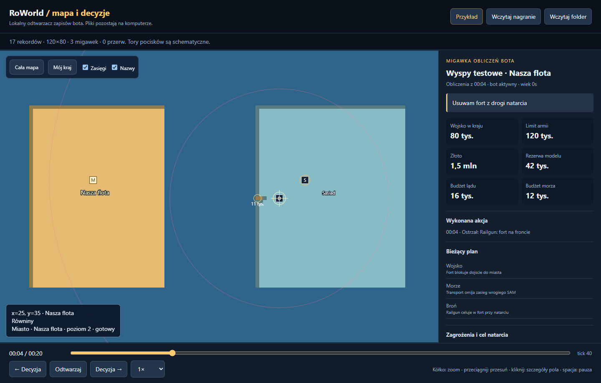

# RoWorldBot

**Bot strategiczny do RoWorld z lokalnym nagrywaniem mapy i odtwarzaczem decyzji.**

Luau / Lua · wersja **9.2** · samodzielny odtwarzacz HTML · 621 lokalnych sprawdzeń

[Uruchomienie](#uruchomienie) · [Nagrania](#nagrania-i-odtwarzanie) · [Dokumentacja](docs/) · [Archiwum](archive/)



## Możliwości

| Obszar | Co robi bot |
| --- | --- |
| Start i ekspansja | Analizuje wolny teren, wybiera start pod koniec odliczania, planuje ekspansję i desanty na wyspy. |
| Armia i obrona | Dobiera wojsko, zachowuje rezerwę, reaguje na ataki, kontruje i obserwuje zmiany granic. |
| Gospodarka | Ocenia zakupy, miasta, porty, fabryki oraz rozmieszczenie fortyfikacji. |
| Broń i marynarka | Uwzględnia silosy, SAM-y, ostrzał, dostępne wyposażenie oraz okręty i ryzyko desantu. |
| Dyplomacja | Rozróżnia graczy i boty, pamięta agresję i zdrady, ocenia propozycje sojuszy. |
| Kalibracja | Zachowuje ograniczony profil wyników; dopasowuje współczynniki na podstawie obserwacji. |
| Powtórki | Zapisuje siatkę mapy, zdarzenia, statki, budynki, wybuchy, plany i wykonane polecenia. |

## Uruchomienie

1. Pobierz [całe repozytorium jako ZIP](https://github.com/Golab00/RoWorldBot/archive/refs/heads/main.zip) i rozpakuj je.
2. Zamknij poprzedni panel przez **F9**.
3. Uruchom [releases/RoWorldAuto_v9_2.lua](releases/RoWorldAuto_v9_2.lua) w swoim środowisku Lua. `releases/RoWorldAuto.lua` zawiera tę samą wersję.
4. W meczu poczekaj na odczyt stanu serwera. **F8** włącza lub pauzuje granie, **F9** zapisuje końcówkę nagrania i zatrzymuje skrypt.
5. Po zmianie serwera uruchom skrypt ponownie. Ustawienia i wyposażenie są dostępne w przewijanym panelu.

Pełna instrukcja: [Instrukcja_RoWorld.txt](docs/Instrukcja_RoWorld.txt).

## Nagrania i odtwarzanie

Nagranie rozpoczyna się po odczycie mapy; może działać również przy pauzie grania przez F8. Autosave następuje co **15 sekund** i przy **F9**.

Pliki `.rwr.jsonl` trafiają do katalogu `RoWorldRecordings` w workspace środowiska wykonującego Lua. Panel pokazuje względną ścieżkę albo błąd. Jeśli dostępne jest tylko `writefile`, zapis dzieli się na numerowane części; zachowaj wszystkie części jednej rundy.

Otwórz [releases/Odtwarzacz_RoWorld.html](releases/Odtwarzacz_RoWorld.html) jako lokalny plik w Edge lub Chrome i wybierz **Wczytaj nagranie**. Suwak, pauza, zmiana tempa i przyciski skoków do decyzji pozwalają przeglądać mecz. Przy mapie są rezerwy, budżety, cele, rozważane warianty, obliczenia i wysłane ruchy.

Przycisk **Przykład** otwiera wbudowaną scenę testową. Ten sam zapis znajduje się w [examples/Przyklad_nagrania.rwr.jsonl](examples/Przyklad_nagrania.rwr.jsonl).

Szczegóły: [Nagrywanie_i_odtwarzanie_v9_2.txt](docs/Nagrywanie_i_odtwarzanie_v9_2.txt).

## Struktura

```text
src/          źródło aktualnego bota
releases/     gotowe pliki Lua i samodzielny odtwarzacz HTML
viewer/       edytowalne źródła odtwarzacza
examples/     demonstracyjne nagranie
tests/        scenariusze Luau, atrapy klienta i testy odtwarzacza
tools/        budowanie, uruchamianie testów i pobieranie zależności
docs/         instrukcje, analizy wersji i opis weryfikacji
archive/      zachowane wcześniejsze wydania
```

## Rozwój i testy

Node.js 22 lub nowszy wystarcza do zbudowania wydania i testów silnika odtwarzacza. Te polecenia nie wymagają instalowania pakietów npm:

```sh
npm run build
npm test
npm run build:check
```

Źródło bota znajduje się w `src/RoWorldAuto.luau`. Budowanie kopiuje je do plików wydania i składa HTML ze źródeł `viewer/` oraz przykładu.

Testy Luau wymagają oficjalnego [Luau CLI](https://github.com/luau-lang/luau), Git oraz modułów oryginalnej gry przypiętych do konkretnego commitu:

```sh
npm run setup:upstream
npm run test:luau
```

Możesz wskazać interpreter przez `LUAU_BIN`, a kompilator przez `LUAU_COMPILE_BIN`. Zależność gry pozostaje lokalnie w ignorowanym katalogu `vendor/roworld`.

Testy interfejsu wymagają Playwright i jego Chromium:

```sh
npm install --no-save --package-lock=false playwright
npx playwright install chromium
npm run test:ui
```

Opcjonalnie `BROWSER_EXECUTABLE` wskazuje istniejącą przeglądarkę. Wyniki i zrzuty testowe trafiają do `.test-output/`.

Weryfikacja v9.2 objęła **621 sprawdzeń**: scenariusze i symulację gry, klienta z atrapami usług, zapis i awarie dysku, przewijanie mapy oraz interfejs Edge i mapę 1600×800. Workflow GitHub sprawdza odtwarzacz i zgodność wygenerowanego wydania. [Szczegóły lokalnej weryfikacji](docs/verification_v9_2.txt).

## Granice działania

Bot stosuje reguły i modele kosztu; nie gwarantuje zwycięstwa ani idealnego rozumienia gry. Profil wyników dopasowuje ograniczone współczynniki, nie trenuje samodzielnie nowego modelu AI. RTX nie jest wymagany do obliczeń tego skryptu.

Powtórka obejmuje dane zaobserwowane od początku nagrywania. Tory pocisków są schematyczne. Stary log diagnostyczny nie zawiera kompletnej siatki do odtworzenia mapy. Bez działającej funkcji zapisu należy skopiować nagranie z RAM przed wyjściem. Publiczna wersja serwera może różnić się od analizowanego źródła.

Zachowano również wcześniejsze, opcjonalne przyciski testów konta i mechanik. Nie są częścią zwykłego sterowania botem; test nagród zmienia saldo Stars i statystyki podłączonego konta. Ich opis znajduje się w pełnej instrukcji. Scenariusze automatyczne wykonują się lokalnie na atrapach i modułach symulatora.

## Źródła

Mechanika i protokół: [lukechatton/roworld](https://github.com/lukechatton/roworld), commit `7919eeba500e473b842e2e11e3c62dee585b39c2`. Informacje o autorach i zależnościach: [NOTICE.md](NOTICE.md). Licencja: [GNU AGPL v3](LICENSE).
